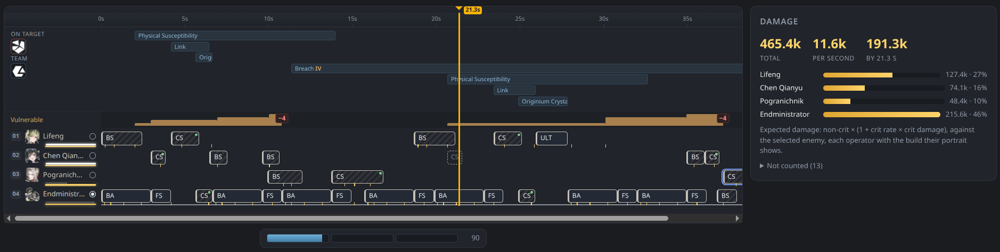
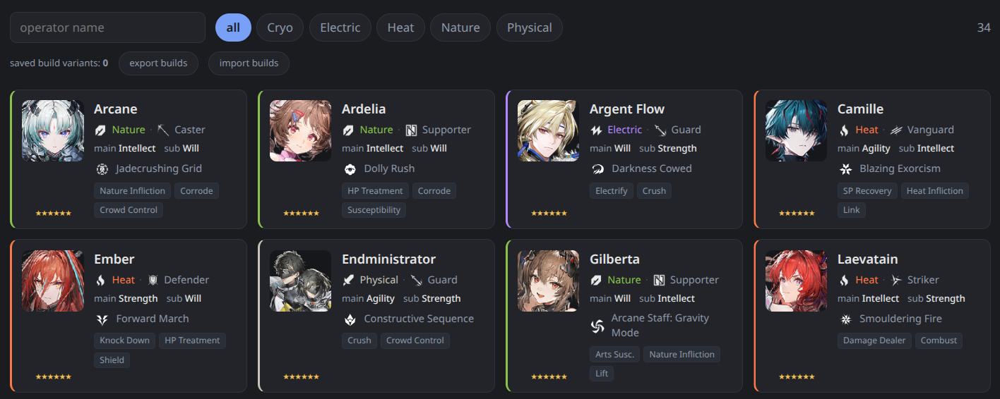
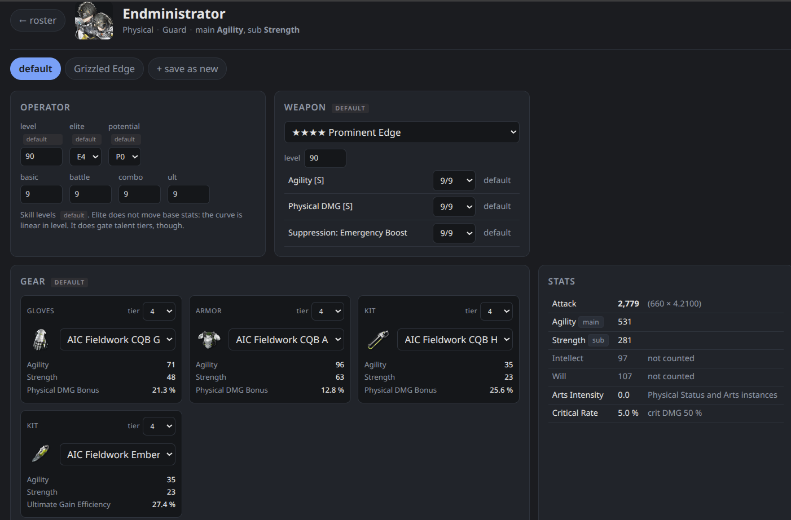
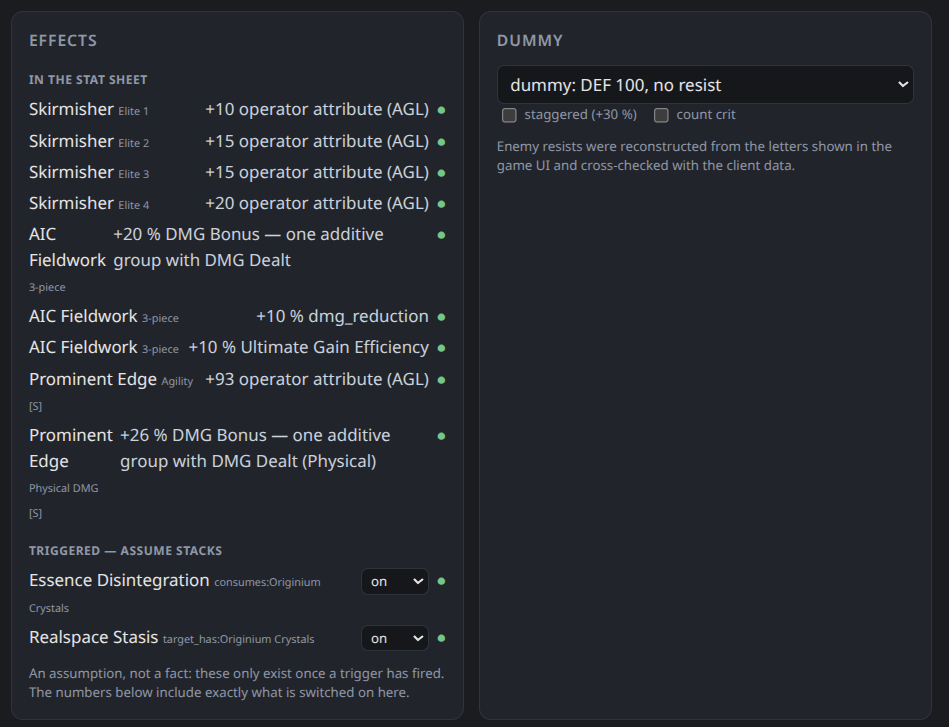
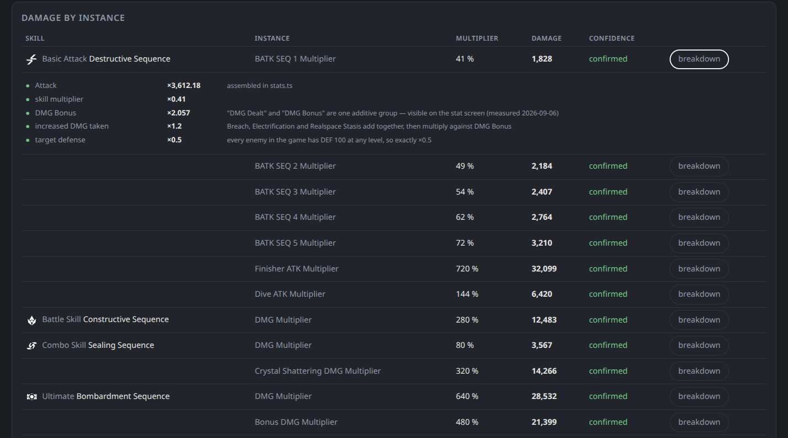
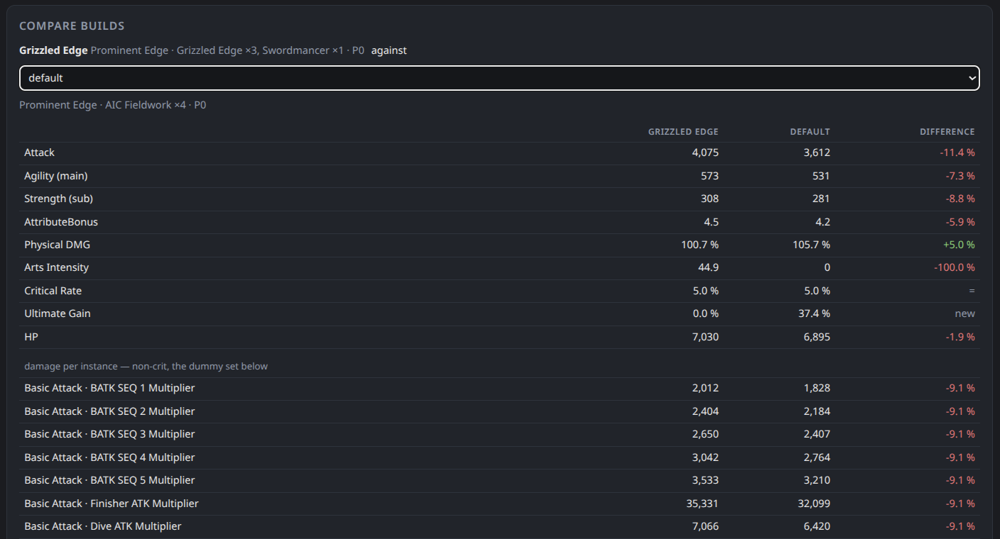
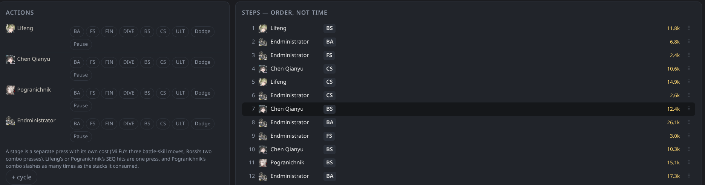
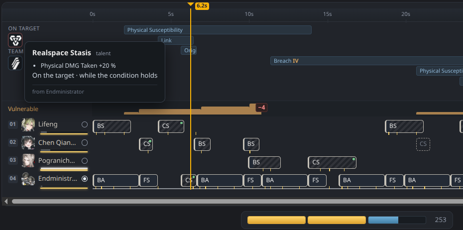
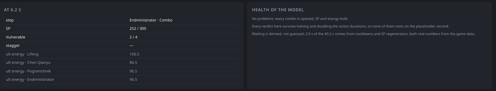
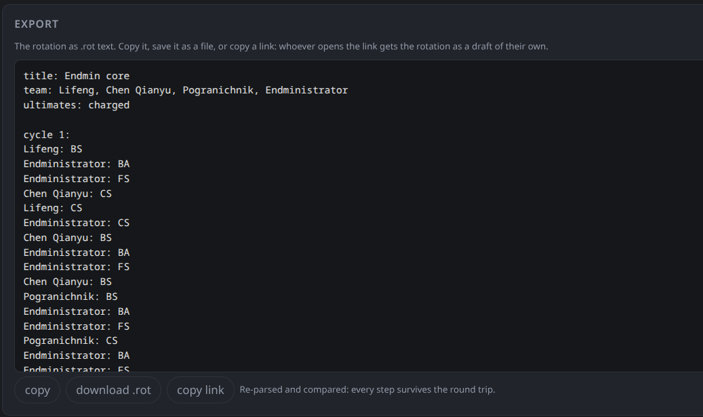

# How to use Andre's Bench

[Русская версия](guide.ru.md)

Andre's Bench has two tools. The **build editor** shows one operator's stats
and the damage of every hit. The **rotation track** plays a whole team's
rotation in time and adds up the damage. Both run in your browser. The site
has no accounts and no server that stores your data.

> **Alpha.** Numbers, the interface and saved formats can still change.
> If a number looks wrong, [open an issue](https://github.com/andresbench/calculator/issues).
> A measurement from the game fixes it for everyone.

## Quick start

1. **Operators** → click an operator. Set the level, potential, skill
   levels, weapon and gear. Until you do, the operator uses a **starter
   build**: skills at 9, a 4★ weapon of their type with columns at 9, and a
   full AIC Fieldwork set. It is there so the numbers aren't zero. It is not
   your account.
2. Do the same for the other three members of your team.
3. **Rotation track** → **+ new**. Click four portraits in the strip at the
   top to fill the team.
4. Under **Actions**, click skills in the order you press them in the game:
   `BS` (battle skill), `CS` (combo), `ULT`, `BA` (basic attack chain).
5. Read the result: total damage and DPS in the **Damage** panel, problems in
   **Health of the model**.
6. **Export → copy link** to share the rotation. Anyone who opens the link
   gets it as their own draft.



## Your data stays in this browser

Builds and rotation drafts are saved in the browser's local storage, on this
device only. Clearing site data deletes them, and a private window starts
empty. To keep a copy or move to another device:

* builds: **Operators → export builds / import builds** (a JSON file);
* rotations: **Export → download .rot**, or copy the link.

## Operators



All released operators, with their element, class, main and secondary
attributes and roles. Use the search box and the element chips to filter.
Click a card to open the build editor.

### Import from Enka

Instead of entering builds by hand, you can load them from your in-game
showcase through [Enka.Network](https://enka.network/):

1. In the game, put the operators you want on your profile showcase.
2. On **Operators**, paste your UID or the link
   `https://enka.network/ef/<UID>/` and press **update from Enka**.
3. The report lists who was on the showcase and what changed. Imported
   values are marked **from game**. Elite is not in the showcase, so it stays
   a **default**.

The showcase only holds a few operators. To import the rest, swap them onto
the showcase and import again: operators seen earlier are kept. Enka caches
a showcase for about a minute, so a change made in game shows up after that.

The request goes through the site's proxy (`enka.andresbench.moe`), because
Enka's API cannot be called from a web page directly. The proxy keeps the
answer for a minute and logs nothing. The imported roster is stored only in
this browser; **forget the imported roster** removes it. A build you edited
by hand is not overwritten by an import: switch back to the showcase variant
to see the imported one.

## Build editor



**Where each value comes from.** Every field has a badge: **by hand** (you
set it) or **default** (nobody set it, so it comes from the starter build).
A default is a stand-in. Treat numbers built on defaults as rough.

* **Operator**: level, elite tier (E0–E4), potential (P0–P5) and the four
  skill levels. Elite does not change base stats, but it unlocks talent
  tiers.
* **Weapon**: the weapon, its level and its Essence columns.
* **Gear**: four slots. The set bonus shows when three pieces of a set are
  equipped.
* **Stats**: the resulting stat sheet, with everything above applied.

**Effects.** Talents, potentials, weapon effects and set bonuses, sorted
into groups:

* **in the stat sheet**: always on, already counted;
* **triggered — assume stacks**: these only exist after something happens
  in the fight ("ATK +8 % for 10 s after a combo"). The editor cannot know
  whether they are up, so you switch them on and pick the stack count. The
  numbers include exactly what you switched on. On the rotation track you
  don't do this: the track works out when they are up;
* **given to the team**: buffs for teammates, shown for reference. The track
  applies them to the teammates;
* **not expressible by the vocabulary**: effects the engine cannot model
  yet. They are listed instead of guessed.



**Dummy.** The enemy the damage table hits: a plain dummy (DEF 100, no
resistances) or any enemy from the game, staggered or not, with or without
crits.



**Damage by instance.** Every damage row of every skill: its multiplier,
the damage and a confidence level. Click **breakdown** to see the formula
factor by factor: ATK, DMG Bonus, Amp, Susceptibility, defense, resistance
and the rest.

### Variants and comparison



**+ save as new** saves the current build as a named variant ("Will",
"Intellect", "borrowed weapon"). Switch variants with the chips at the top.
The active variant is the one the rotation track uses.

**Compare builds** puts two variants side by side against the same dummy,
row by row, with the difference.

## Rotation track

### Starting a rotation

The track opens on an example, **Endmin core** (Lifeng, Chen Qianyu,
Pogranichnik, Endministrator). It is a working rotation, not an optimal
one: it was written for a team without potentials. The example is read
only. **copy** makes an editable draft of it, and so does dropping an
operator on the track.

* **+ new** opens an empty draft.
* **Import** reads `.rot` text or a file. Each variant in the file becomes
  its own draft.
* A shared link opens as a draft automatically.

Drafts are listed in the selector at the top left. Use **copy** to fork one
and **delete draft** to remove it.

### Team

Click a portrait in the strip to put that operator in the next free slot,
or drag it onto the track. Hover a portrait to see the build the track will
use for that operator. The track always uses the operator's active build, so
editing a build changes the numbers in every rotation with that operator.

**Slot order matters to the game.** It sets the default combo priority, and
some effects aim at slot 01. Drag the lane heads on the track to swap slots.
Clicking ✕ on a team chip removes the operator together with their steps.

### Steps — order, not time



**Actions** has a row of buttons per operator:

| button | what it is |
|---|---|
| `BA` | basic attack chain, up to the Final Strike |
| `FS` | Final Strike on its own |
| `FIN` | Finisher, on a staggered enemy |
| `DIVE` | dive (plunging) attack |
| `BS` | battle skill |
| `CS` | combo skill |
| `ULT` | ultimate |
| Dodge | a perfect dodge: +7 SP |
| Pause | time passes and nothing else happens; set the length on the step |

A click adds the action after the selected step, or at the end if none is
selected. **+ cycle** starts a new cycle, which helps when reading longer
rotations.

The step list is the **order of presses**. You don't place steps in time.
Each step is pressed at the earliest moment the game allows: the button is
off cooldown, there is enough SP, the operator is free, and for the
controlled operator, their attack chain has finished. Other operators'
skills run alongside the controlled operator's chain. If a step has to wait
(cooldown, SP), the track draws the wait and says how long it is.

Click a step to select it. You can then mark it **optional (~)** or
**uncertain (?)**, add a comment, or drag it by ⠿ to move it. A **!** next to
a step means the engine has a problem with it. **Health of the model**
explains the problem.

### Reading the track



* **Lanes**: one per operator, time from left to right. Each block is a
  step. Ticks on a block mark the moments its hits land. A pale tail is the
  part of the animation after the last hit.
* **Ribbon** above the lanes: buffs and debuffs, on the target and on the
  team, for as long as they last. The **Vulnerable** counter is drawn as a
  step graph (up to 4), and so are Arts Infliction stacks.
* **Dashed blocks**: a combo that opened but that your rotation never
  presses before it closes. Click one to add it. A dashed Final Strike means
  a basic attack chain stopped short of it, so it gave no Final Strike SP.
* **Cursor**: drag the ruler, or use ← / → to jump between actions (Shift +
  arrow moves by 0.1 s). The **At … s** panel shows what stands at that
  moment: SP, Vulnerable stacks, stagger, each operator's ultimate energy.
* **Controlled operator**: the small circle on a lane head. By default the
  first operator to attack is the one you control. Click a circle to start
  the fight with someone else.
* **SP bar** under the track: team SP at the cursor (3 bars of 100).
* Hover blocks, bars and markers: most of them explain themselves.

### Damage

**Damage** shows the total, DPS, and damage up to the cursor, plus each
operator's share. The track reports *expected* damage: non-crit damage ×
(1 + crit rate × crit damage). It is computed against the enemy chosen at
the top left. **dummy: no stagger meter** never gets staggered. **dummy:
stagger meter of a typical Boss** gets staggered and opens Finishers.

**Not counted (N)** lists what this rotation relies on but the engine does
not model. Don't skip it.

### Health of the model



* **Problems**: combos pressed without a trigger, SP or energy running
  short, a combo pressed while it is still on cooldown.
* **Robustness**: some action durations are not in the client data, so a
  placeholder second stands in for them. The track replays the rotation with
  those durations halved and doubled. If a verdict changes, it is listed:
  it rests on a guess and waits for a measurement.
* **Waiting**: how much of the rotation is spent waiting on cooldowns and
  SP.

### Rotation settings

* **Combo priority**: the in-game setting that decides who goes first when
  several combos trigger at the same moment. The default is team order.
* **the fight starts with ultimates charged**: as after a previous wave.
* **SP without limit**: battle skills never wait for SP. Use it to sketch
  the order before you worry about resources.

### Export and links



**Export** shows the rotation as `.rot` text. You can copy it, download it
as a file, or **copy link**. The link carries the whole rotation inside the
address, so nothing is stored on a server, and it opens as long as the site
can read the format.

## The `.rot` notation

You can build a rotation without writing any text. The notation exists for
copying, diffing and forums:

```
title: Endmin core
team: Chen Qianyu, Endministrator, Ember, Pogranichnik
priority: Endministrator, Chen Qianyu   # optional: combo priority
controlled: Chen Qianyu                 # optional: who is controlled at the start

variant: basic
cycle 1:
Chen Qianyu: BS > CS
Endministrator: CS
Ember: CS          [comments go in square brackets]
Endministrator: BS
Chen Qianyu: WAIT 2.5s
Pogranichnik: CS~
Chen Qianyu: DODGE
```

`A > B` on one line means the same operator presses A, then B. `~` after
an action marks it optional and `?` marks it uncertain. `WAIT 2.5s` is a
pause and `DODGE` a perfect dodge. `BS2` and
`CS1` are stages of a multi-press skill. Operator names can be short or in
Russian, for example `Chen` or `Чэнь`. An empty team slot is written `-`.

## What to trust

Every number is one of three kinds:

* **fact**: from the game data (wiki, client) or measured in the game;
* **assumption**: a reading of a text the data does not settle. It is named
  as an assumption next to the number;
* **not counted**: listed next to the total.

The engine is tested against numbers measured in the game. Each measurement
is published with its protocol and tolerance in
[measurements.md](measurements.md). The open questions are there too, and
anyone with the game can close one.
