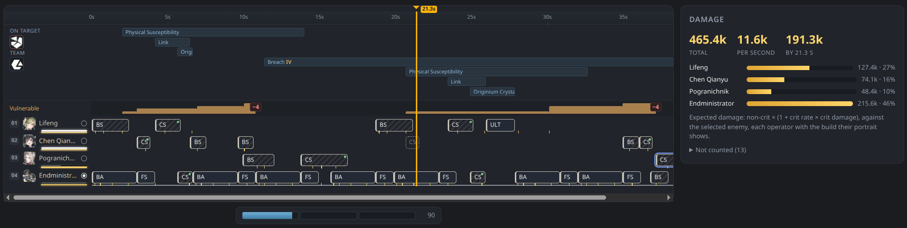
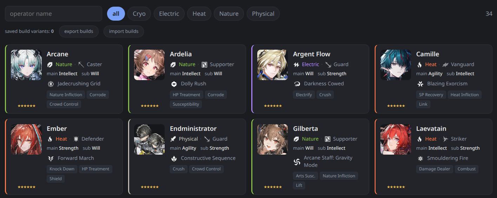
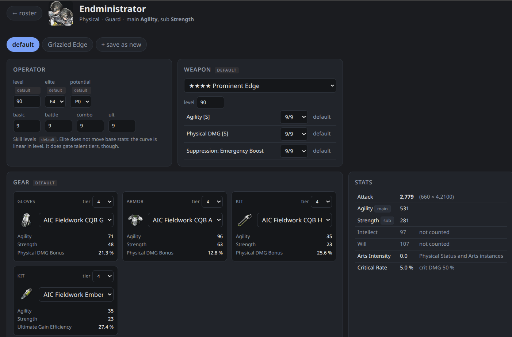
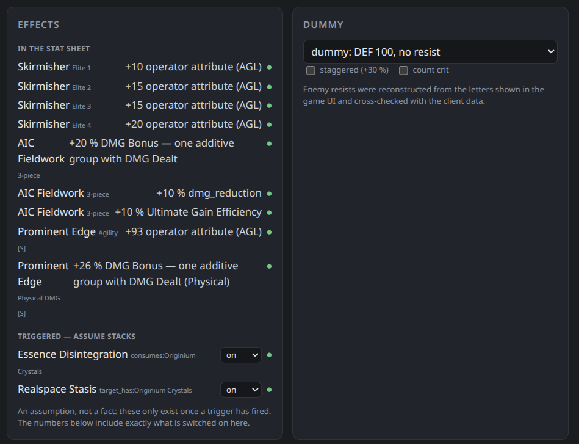
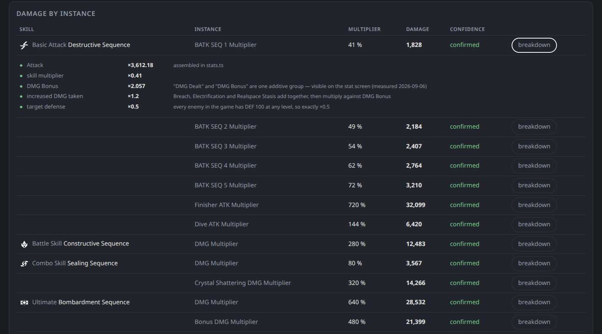
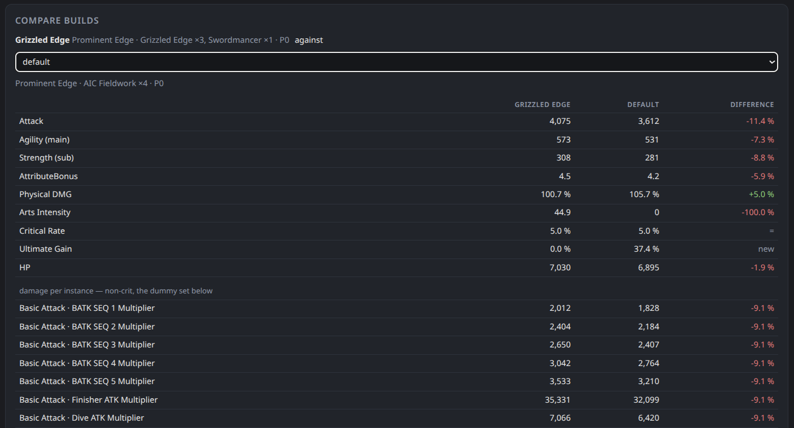
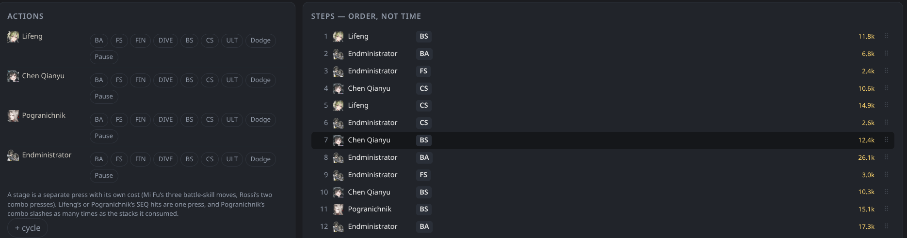
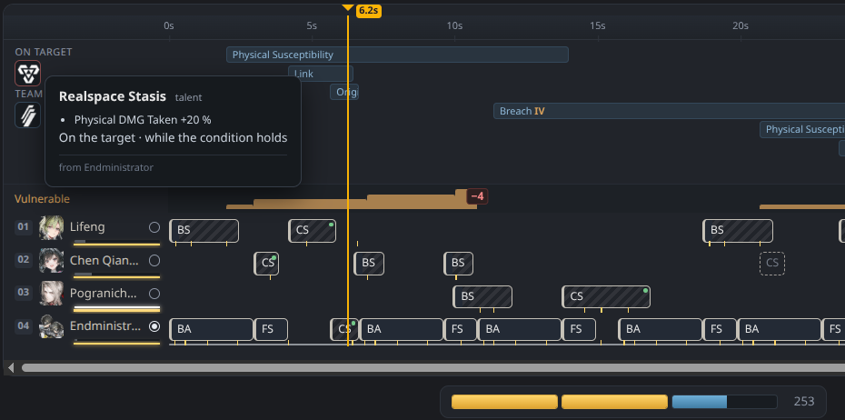
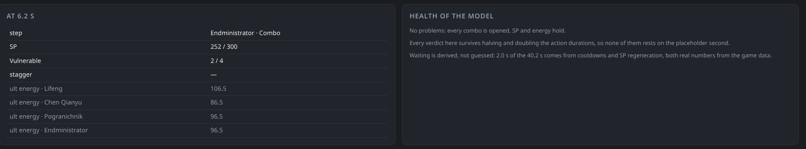
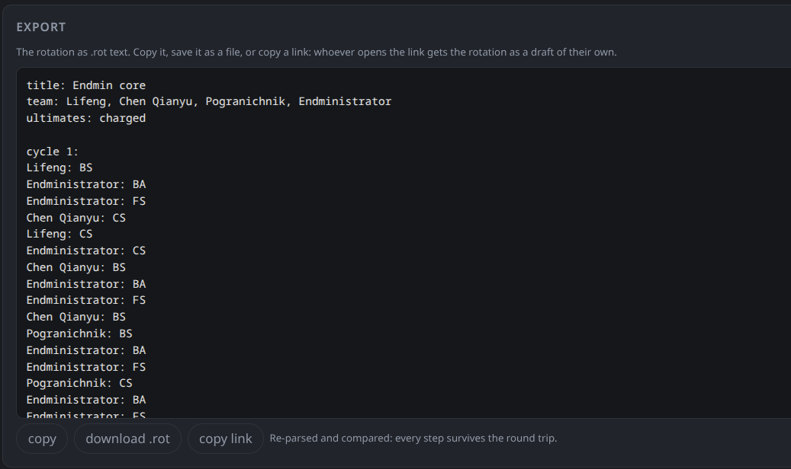

# Как пользоваться Andre's Bench

[English version](guide.md)

В Andre's Bench два инструмента. **Редактор билда** показывает статы
одного оператора и урон каждого удара. **Трек ротации** проигрывает ротацию
всего отряда во времени и складывает урон. Оба работают в браузере.
Аккаунтов нет, сервера, который хранил бы ваши данные, тоже нет.

> **Альфа.** Числа, интерфейс и форматы сохранений ещё могут меняться.
> Если число выглядит неверным, [заведите issue](https://github.com/andresbench/calculator/issues):
> замер из игры исправит его для всех.

## Быстрый старт

1. **Операторы** → нажмите на оператора. Выставьте уровень, потенциал,
   уровни навыков, оружие и снаряжение. Пока вы этого не сделали, у
   оператора **стартовый билд**: навыки 9, оружие 4★ его типа с колонками
   на 9 и полный сет AIC Fieldwork. Он нужен, чтобы числа не были нулевыми,
   и к вашему аккаунту отношения не имеет.
2. То же для остальных трёх в отряде.
3. **Трек ротаций** → **+ новая**. Нажмите на четыре портрета в полосе
   сверху, чтобы собрать отряд.
4. В **Действиях** нажимайте навыки в том порядке, в каком жмёте их в игре:
   `BS` (боевой навык), `CS` (комбо), `ULT` (ульта), `BA` (цепочка обычных
   атак).
5. Смотрите результат: общий урон и DPS — в панели **Урон**, проблемы — в
   **Здоровье модели**.
6. **Экспорт → скопировать ссылку**, чтобы поделиться ротацией. Кто откроет
   ссылку, получит её своим черновиком.



## Данные остаются в этом браузере

Билды и черновики ротаций хранятся в локальном хранилище браузера, только
на этом устройстве. Очистка данных сайта их удаляет, а приватное окно
открывается пустым. Чтобы сохранить копию или перенести на другое
устройство:

* билды: **Операторы → экспорт билдов / импорт билдов** (файл JSON);
* ротации: **Экспорт → скачать .rot** или ссылка.

## Операторы



Все вышедшие операторы: стихия, класс, основной и дополнительный атрибуты,
роли. Фильтр — поиск по имени и кнопки стихий. Нажмите на карточку, чтобы
открыть редактор билда.

### Импорт из Enka

Вместо ручного ввода билды можно загрузить с витрины профиля в игре через
[Enka.Network](https://enka.network/):

1. В игре выставьте на витрину профиля нужных операторов.
2. На экране **Операторы** вставьте свой UID или ссылку
   `https://enka.network/ef/<UID>/` и нажмите **обновить из Enka**.
3. В отчёте видно, кто был на витрине и что изменилось. Импортированные
   значения помечены **из игры**. Элитизации в витрине нет, поэтому она
   остаётся **по умолчанию**.

На витрине помещается всего несколько операторов. Чтобы загрузить
остальных, выставьте их и импортируйте снова: увиденные раньше сохраняются.
Enka кэширует витрину примерно на минуту, так что изменения в игре видны
после этого.

Запрос идёт через прокси сайта (`enka.andresbench.moe`): напрямую со
страницы к API Enka обратиться нельзя. Прокси держит ответ минуту и не
ведёт логов. Импортированный ростер хранится только в этом браузере;
**забыть импортированный ростер** удаляет его. Билд, который вы правили
руками, импорт не перезаписывает: чтобы увидеть импортированный, вернитесь
к варианту «витрина».

## Редактор билда



**Откуда каждое значение.** У каждого поля есть метка: **вручную** (вы
выставили) или **по умолчанию** (никто не выставлял, взято из стартового
билда). Значение по умолчанию — заглушка. Числа, которые на нём стоят,
считайте грубыми.

* **Оперативник**: уровень, элитизация (E0–E4), потенциал (P0–P5) и четыре
  уровня навыков. Элитизация не меняет базовые статы, но открывает
  ступени талантов.
* **Оружие**: само оружие, его уровень и колонки Эссенции.
* **Снаряжение**: четыре слота. Бонус сета появляется, когда надеты три
  предмета одного сета.
* **Статы**: итоговый лист характеристик со всем, что выше.

**Эффекты.** Таланты, потенциалы, эффекты оружия и бонусы сетов, разложенные
по группам:

* **в листе статов**: работают всегда и уже учтены;
* **по триггеру — допустить стаки**: появляются только после события в бою
  («ATK +8 % на 10 с после комбо»). Редактор не знает, висят ли они, поэтому
  их включаете вы и выбираете число стаков. В числа входит ровно то, что
  включено. На треке ротации этого делать не нужно: трек сам считает,
  когда они висят;
* **отдаётся отряду**: баффы союзникам, показаны для справки. Трек
  накладывает их на союзников;
* **не выражается словарём**: эффекты, которые движок пока не умеет. Они
  перечислены, а не угаданы.



**Манекен.** Враг, по которому считается таблица урона: простой манекен
(DEF 100, без сопротивлений) или любой враг из игры, ошеломлённый или нет,
с критом или без.



**Урон по инстансам.** Каждая строка урона каждого навыка: множитель, урон
и уровень уверенности. **Разбор** раскрывает формулу по множителям: ATK,
DMG Bonus, Amp, Susceptibility, защита, сопротивление и остальное.

### Варианты и сравнение



**+ сохранить как новый** сохраняет текущий билд как именованный вариант
(«Will», «Intellect», «чужое оружие»). Переключаются варианты кнопками
сверху. Трек ротации берёт активный вариант.

**Сравнение билдов** ставит два варианта рядом против одного манекена,
строка к строке, с разницей.

## Трек ротации

### С чего начать

Трек открывается на примере **Endmin core** (Лифэн, Чэнь Цяньюй,
Пограничник, Эндминистратор). Это рабочая ротация, но не оптимальная: она
написана под отряд без потенциалов. Пример только для чтения.
**Копировать** делает из него черновик, который можно править; то же
происходит, если перетащить оператора на трек.

* **+ новая** открывает пустой черновик.
* **Импорт** читает текст `.rot` или файл. Каждый вариант из файла
  становится отдельным черновиком.
* Присланная ссылка сама открывается черновиком.

Черновики — в списке слева сверху. **Копировать** делает копию, **удалить
черновик** удаляет.

### Отряд

Нажмите на портрет в полосе, чтобы поставить оператора в следующий
свободный слот, или перетащите его на трек. При наведении портрет
показывает билд, с которым трек будет считать этого оператора. Трек всегда
берёт активный билд оператора, поэтому правка билда меняет числа во всех
ротациях с этим оператором.

**Порядок слотов игре важен.** Он задаёт приоритет комбо по умолчанию, а
некоторые эффекты целятся в слот 01. Чтобы поменять слоты местами,
перетаскивайте заголовки дорожек на треке. ✕ на плашке отряда убирает
оператора вместе с его шагами.

### Шаги — порядок, а не время



В **Действиях** у каждого оператора свой ряд кнопок:

| кнопка | что это |
|---|---|
| `BA` | цепочка обычных атак до последнего удара |
| `FS` | только последний удар (Final Strike) |
| `FIN` | добивание (Finisher) по ошеломлённому врагу |
| `DIVE` | атака в падении |
| `BS` | боевой навык |
| `CS` | комбонавык |
| `ULT` | ульта |
| Уворот | идеальный уворот: +7 SP |
| Пауза | проходит время, больше ничего; длина задаётся на шаге |

Нажатие добавляет действие после выбранного шага, а если шаг не выбран — в
конец. **+ цикл** начинает новый цикл: длинную ротацию так проще читать.

Список шагов — это **порядок нажатий**. Расставлять шаги по времени не
нужно. Каждый шаг нажимается в самый ранний момент, который разрешает
игра: кнопка не на откате, SP хватает, оператор свободен, а у управляемого
оператора ещё и закончилась цепочка атак. Навыки остальных идут
параллельно цепочке управляемого. Если шаг ждёт (откат, SP), трек рисует
ожидание и пишет, сколько оно длится.

Нажмите на шаг, чтобы выбрать его. После этого его можно отметить
**необязательным (~)** или **под вопросом (?)**, добавить комментарий или
перетащить за ⠿ в другое место. **!** рядом с шагом значит, что у движка к
нему претензия. Какая — написано в **Здоровье модели**.

### Как читать трек



* **Дорожки**: одна на оператора, время слева направо. Блок — это шаг.
  Риски на блоке — моменты, когда приходят удары. Бледный хвост — часть
  анимации после последнего удара.
* **Лента** над дорожками: баффы и дебаффы на цели и на отряде, пока они
  длятся. Счётчик **Уязвимости** нарисован ступеньками (до 4), так же стаки
  Arts Infliction.
* **Пунктирные блоки**: комбо открылось, но ротация не нажала его, пока
  окно не закрылось. Нажмите на такой блок, чтобы добавить. Пунктирный
  Final Strike значит, что цепочка обычных атак до него не дошла, и SP за
  последний удар не пришли.
* **Курсор**: тяните линейку или жмите ← / →, чтобы прыгать между
  действиями (с Shift — по 0.1 с). Панель **На … с** показывает, что стоит
  в этот момент: SP, стаки Уязвимости, ошеломление, энергию ульты каждого.
* **Управляемый оператор**: кружок в заголовке дорожки. По умолчанию
  управляемый — тот, кто атакует первым. Нажмите на кружок, чтобы начать
  бой за другого.
* **Полоска SP** под треком: SP отряда в точке курсора (3 деления по 100).
* Наводите на блоки, полосы и отметки: почти все объясняют себя сами.

### Урон

**Урон** показывает общий урон, DPS, урон к моменту курсора и долю каждого
оператора. Трек считает *ожидаемый* урон: урон без крита × (1 + шанс крита
× крит. урон). Цель — враг, выбранный слева сверху. **манекен: без шкалы
ошеломления** никогда не ошеломляется. **манекен: шкала ошеломления
типичного Boss** ошеломляется и открывает добивания.

**Не учтено (N)** — то, на что ротация опирается, а движок не моделирует.
Не пропускайте этот список.

### Здоровье модели



* **Проблемы**: комбо без триггера, нехватка SP или энергии, комбо нажато,
  пока оно ещё на откате.
* **Устойчивость**: у некоторых действий длительности нет в данных
  клиента, вместо неё стоит условная секунда. Трек переигрывает ротацию с
  этими длительностями, уменьшенными вдвое и увеличенными вдвое. Если
  вывод при этом меняется, он попадает в список: он держится на догадке и
  ждёт замера.
* **Ожидание**: сколько времени ротации уходит на ожидание откатов и SP.

### Настройки ротации

* **Приоритет комбонавыков**: настройка из игры, кто ходит первым, когда
  несколько комбо срабатывают в один момент. По умолчанию — порядок отряда.
* **бой начинается с заряженными ультами**: как после предыдущей волны.
* **SP без ограничений**: боевые навыки никогда не ждут SP. Удобно набросать
  порядок, пока ресурсы не важны.

### Экспорт и ссылки



**Экспорт** показывает ротацию текстом `.rot`. Его можно скопировать,
скачать файлом или **скопировать ссылку**. Вся ротация лежит в самом
адресе ссылки, на сервере ничего не хранится, и ссылка откроется, пока сайт
понимает этот формат.

## Запись `.rot`

Ротацию можно собрать, не написав ни строчки текста. Запись нужна, чтобы
копировать, сравнивать версии и выкладывать на форумы:

```
title: Endmin core
team: Chen Qianyu, Endministrator, Ember, Pogranichnik
priority: Endministrator, Chen Qianyu   # необязательно: приоритет комбо
controlled: Chen Qianyu                 # необязательно: кто управляем в начале

variant: basic
cycle 1:
Chen Qianyu: BS > CS
Endministrator: CS
Ember: CS          [комментарии — в квадратных скобках]
Endministrator: BS
Chen Qianyu: WAIT 2.5s
Pogranichnik: CS~
Chen Qianyu: DODGE
```

`A > B` в одной строке значит, что один и тот же оператор жмёт A, потом B.
`~` после действия отмечает его необязательным, `?` — под вопросом.
`WAIT 2.5s` — пауза, `DODGE` — идеальный уворот. `BS2` и `CS1` — стадии
навыка из нескольких нажатий. Имена можно писать коротко или по-русски,
например `Chen` или `Чэнь`; заголовок цикла можно писать как `цикл 1:`.
Пустой слот отряда записывается как `-`.

## Чему верить

Каждое число одного из трёх видов:

* **факт**: из игровых данных (вики, клиент) или замерено в игре;
* **допущение**: прочтение текста, которое данные не решают. Рядом с
  числом оно названо допущением;
* **не учтено**: перечислено рядом с итогом.

Движок проверяется числами, замеренными в игре. Каждый замер опубликован с
протоколом и допуском в [measurements.ru.md](measurements.ru.md). Там же
открытые вопросы, и закрыть любой может каждый, у кого есть игра.
